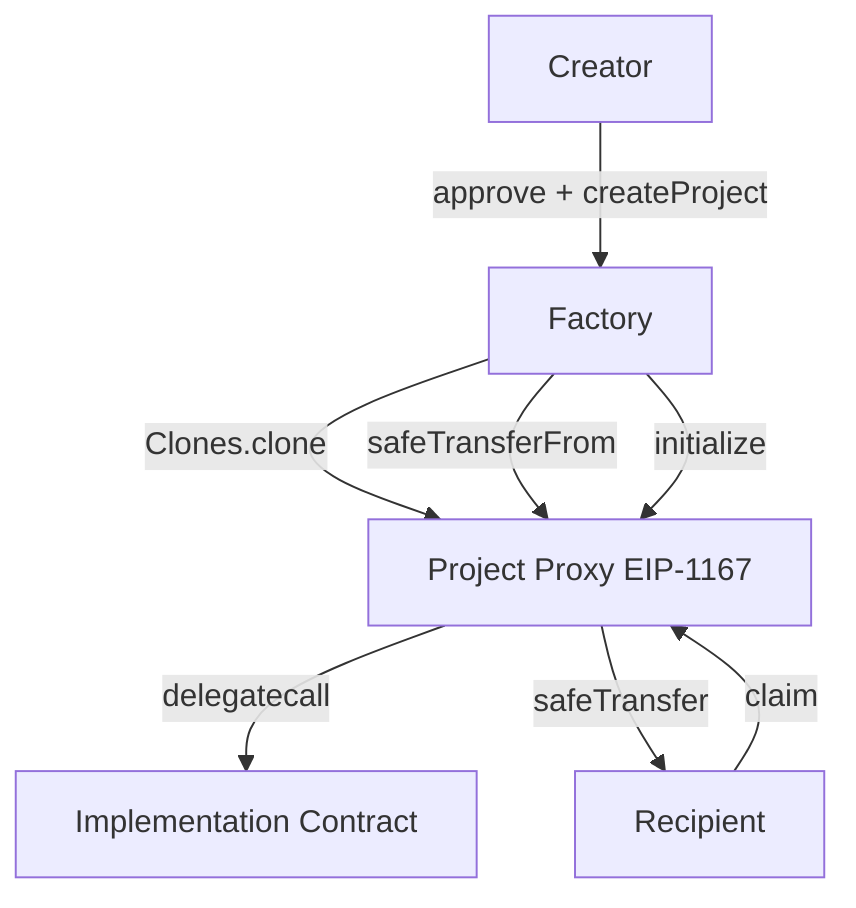

# TokenDis Smart-Contract Design Doc

**Status:** Draft  
**Authors:** TokenShoe Team  
**Target Chain:** Arc Testnet → Arc Mainnet  
**Language / Toolchain:** Solidity 0.8.24, Foundry (forge 0.2.x)  
**Milestone:** MVP — ERC-20 token distribution only  

**Review Tracker:**
- [ ] Design Review
- [ ] Security Review
- [ ] Ops Review

---

## Action Items (living)

_Empty — fill after each review round._

---

## 1. Goals / Non-Goals

### Goals
- Let any project creator deploy a token-distribution contract in a single transaction via a factory.
- Support three distribution modes: Merkle airdrop, signature-based airdrop, and vesting/unlock.
- Guarantee recipients can always claim what is owed to them — creators cannot rug deposited funds before a claim window closes.
- Keep deployed contract addresses deterministic and predictable (CREATE2 via OpenZeppelin Clones + a per-creator salt).
- Open-source, verifiable contracts on the Arc block explorer.

### Non-Goals
- Fee-on-transfer, rebasing, or non-standard ERC-20 tokens are explicitly out of scope.
- Cross-chain bridging or multi-chain distribution in a single transaction.
- On-chain governance over distribution parameters post-deployment.
- Upgrading individual project proxies after deployment (each project permanently points to the implementation it was created with).
- Native-coin (ETH/ARC gas) distribution — ERC-20 only.

---

## 2. Terminology & Actors

| Term | Definition |
|---|---|
| Factory | `TokenDisFactory` — deploys and tracks all projects |
| Implementation | One of three base contracts registered by type: `TokenMerkleDis`, `TokenSignDis`, `TokenVesting` |
| Project | A minimal proxy (EIP-1167 clone) of an implementation, holding tokens for one distribution |
| Creator | Address that calls `createProject`; owns the project proxy |
| Recipient | Address entitled to claim tokens from a project |
| Signer | Backend-controlled EOA that issues EIP-712 signatures for `TokenSignDis` |
| Platform Admin | Owner of `TokenDisFactory`; registers implementations, sets platform params |

| Actor | On/Off-chain | Trust Level | Capabilities |
|---|---|---|---|
| Platform Admin | On-chain key (cold) | Trusted | Register/upgrade implementations; set platform params |
| Creator | On-chain EOA/multisig | Semi-trusted | Create projects; pause/unpause; addSchedules; withdraw recoverables; fund |
| Recipient | On-chain EOA | Untrusted | Claim tokens via proof/signature/time |
| Signer Service | Off-chain backend | Semi-trusted | Issue EIP-712 claim signatures for `TokenSignDis` |
| Anyone | On-chain | Untrusted | Call `fund(amount)`, call `claim` on behalf of another address (tokens go to the recipient address, not caller) |

---

## 3. Language / Runtime

- **Solidity 0.8.24** — built-in checked arithmetic; `custom error` for gas-efficient reverts.
- **EVM target: Paris** — Arc Testnet and Arc Mainnet run the Paris hardfork; no Cancun opcodes used.
- **Foundry (forge)** for compilation, testing, and deployment.
- **OpenZeppelin Contracts 5.1.0** — pinned; 5.2.0+ uses `mcopy` (Cancun) which is incompatible with Paris.
  - Used: `Clones`, `OwnableUpgradeable` (Ownable2Step pattern applied manually), `PausableUpgradeable`, `ReentrancyGuardUpgradeable`, `EIP712Upgradeable`, `SafeERC20`, `BitMaps`.
- **No UUPS / transparent proxy on individual projects** — EIP-1167 minimal proxies only; implementations are not themselves upgradeable.

---

## 4. Transaction & Execution Model

All state is committed atomically or reverted entirely. Re-entry surfaces:

| Function | External call | Guard |
|---|---|---|
| `createProject` | `safeTransferFrom` (token → project) | CEI: clone + init first, transfer last; `nonReentrant` not needed (no value loop) |
| `TokenDisBase.fund` | `safeTransferFrom` | CEI; no loop |
| `TokenMerkleDis.claim` | `safeTransfer` (token → recipient) | CEI: mark claimed in BitMap BEFORE transfer; `nonReentrant` |
| `TokenSignDis.claim` | `safeTransfer` | CEI: set `usedClaimIds[claimId] = true` BEFORE transfer; `nonReentrant` |
| `TokenVesting.claim` | `safeTransfer` | CEI: update `claimed` on schedule BEFORE transfer; `nonReentrant` |
| `TokenDisBase.withdraw` | `safeTransfer` | CEI; `nonReentrant` |

---

## 5. Architecture Overview



**Flow of funds:**

| Step | Who | What | Invariant |
|---|---|---|---|
| 1 | Creator | `approve(factory, fundAmount)` on token | Creator token balance decreases |
| 2 | Factory | `safeTransferFrom(creator, proxy, fundAmount)` | `proxy.balance == fundAmount` after init |
| 3 | Anyone | `fund(amount)` — `safeTransferFrom(msg.sender, proxy, amount)` | `proxy.balance` increases by `amount` |
| 4 | Recipient | `claim(...)` — proxy sends tokens to recipient | `proxy.balance` decreases; `totalClaimed` increases |
| 5 | Creator | `withdraw(to, amount)` — recovers unclaimed/unallocated | Only recoverable portion; `proxy.balance` decreases |

**Resting-state invariant:** `proxy.token.balanceOf(proxy) >= (totalAllocated - totalClaimed)` at all times for Vesting; `proxy.token.balanceOf(proxy) >= 0` for airdrop types (no on-chain per-address allocation).

---

## 6. Contract Design

### 6.1 TokenDisFactory

**Roles:**

| Role | Holder | Permissions |
|---|---|---|
| `owner` (Ownable2Step) | Platform Admin | `setImplementation`, set platform params, transfer ownership |
| Anyone | — | `createProject`, `predictAddress`, view queries |

**Key storage:**
```
mapping(uint8 => address) public implementations;   // type → current impl
mapping(address => address[]) public projectsOf;    // creator → proxies
address[] public allProjects;
```

**Key functions:**

| Function | Caller | State changed | Events | Reverts if |
|---|---|---|---|---|
| `setImplementation(uint8 t, address impl)` | owner | `implementations[t] = impl` | `ImplementationSet(t, impl)` | `impl == address(0)` |
| `createProject(uint8 t, address token, uint256 amount, bytes32 userSalt, bytes calldata initData)` | anyone | clone deployed; `projectsOf[msg.sender]` appended; `allProjects` appended | `ProjectCreated(proxy, t, msg.sender, token, amount)` | impl not registered; token zero; amount zero; clone fails; transfer fails |
| `predictAddress(uint8 t, address creator, bytes32 userSalt)` | anyone (view) | — | — | impl not registered |

**Salt derivation:** `salt = keccak256(abi.encodePacked(creator, userSalt))` — prevents frontrunning another creator's address.

**Predicted address:** `Clones.predictDeterministicAddress(implementations[t], salt, address(this))`.

**Upgrade semantics:** `setImplementation` replaces the registered impl for future projects only. Existing proxies are unaffected.

---

### 6.2 TokenDisBase (abstract)

Shared storage and logic for all three implementations.

**Storage (EIP-7201 namespace `tokendis.base`):**
```
address public token;
address public creator;        // project owner (set on init, Ownable2Step-style transfer)
address public pendingCreator;
uint256 public totalFunded;
uint256 public totalClaimed;
bool    public paused;         // airdrop types only; Vesting ignores
```

**Functions:**

| Function | Caller | Notes |
|---|---|---|
| `__TokenDisBase_init(address token_, address creator_, uint256 amount_)` | impl's `initialize` | sets token, creator, emits `Funded` |
| `fund(uint256 amount)` | anyone | `safeTransferFrom(msg.sender, address(this), amount)`; emits `Funded` |
| `pause()` / `unpause()` | creator | sets `paused`; emits `Paused`/`Unpaused` |
| `withdraw(address to, uint256 amount)` | creator | calls `_recoverableAmount()`; transfers; emits `Withdrawn` |
| `transferCreator(address newCreator)` | creator | two-step: sets `pendingCreator`; emits `CreatorTransferInitiated` |
| `acceptCreator()` | `pendingCreator` | finalizes; emits `CreatorTransferred` |

**`_recoverableAmount()` (virtual):** overridden per subcontract:
- `TokenMerkleDis` / `TokenSignDis`: `token.balanceOf(this)` after end time.
- `TokenVesting`: `token.balanceOf(this) - (totalAllocated - totalClaimed - revokedUnlocked)`.

**Unified Claimed event (same shape for all three):**
```solidity
event Claimed(address indexed account, uint256 indexed claimKey, uint256 amount);
```
`claimKey` = Merkle index | SignDis claimId | Vesting schedule id.

---

### 6.3 TokenMerkleDis

**Additional storage:**
```
bytes32 public merkleRoot;
uint64  public startTime;
uint64  public endTime;
BitMaps.BitMap private _claimed;   // index → claimed
```

**Initialize params (ABI-decoded from `initData`):**
```
(bytes32 root, uint64 startTime, uint64 endTime)
```

**Functions:**

| Function | Caller | Notes |
|---|---|---|
| `initialize(address token, address creator, uint256 amount, bytes calldata initData)` | factory (once) | calls `__TokenDisBase_init`; sets root/times |
| `claim(uint256 index, address account, uint256 amount, bytes32[] calldata proof)` | anyone | verifies proof, marks BitMap, transfers; reverts if claimed/invalid/paused/out-of-window |
| `setRoot(bytes32 newRoot)` | creator | only before `startTime`; emits `RootUpdated` |
| `isClaimed(uint256 index)` | anyone (view) | reads BitMap |

**Leaf encoding (OpenZeppelin `StandardMerkleTree` double-hash):**
```solidity
bytes32 leaf = keccak256(bytes.concat(keccak256(abi.encode(index, account, amount))));
```

**Recoverability:** `token.balanceOf(this)` returned by `_recoverableAmount()` only after `endTime`.

---

### 6.4 TokenSignDis

**Additional storage:**
```
address public signer;
mapping(bytes32 => bool) public usedClaimIds;
uint64  public startTime;
uint64  public endTime;
```

**Initialize params:**
```
(address signer, uint64 startTime, uint64 endTime)
```

**EIP-712 domain:** `name = "TokenSignDis"`, `version = "1"`, `chainId`, `verifyingContract = address(this)`.

**Typed struct:**
```solidity
struct ClaimRequest {
    address account;
    uint256 amount;
    bytes32 claimId;
    uint256 deadline;
}
```

**`claimId` convention (off-chain):** `keccak256(abi.encodePacked(projectAddress, account, round))` — one-per-address-per-round.

**Functions:**

| Function | Caller | Notes |
|---|---|---|
| `initialize(...)` | factory | sets signer, times |
| `claim(address account, uint256 amount, bytes32 claimId, uint256 deadline, bytes calldata sig)` | anyone | verify sig, deadline, claimId unused; mark used; transfer; `nonReentrant` |
| `setSigner(address newSigner)` | creator | emits `SignerUpdated` |

---

### 6.5 TokenVesting

**Vesting schedule struct:**
```solidity
struct Schedule {
    address beneficiary;
    uint256 totalAmount;       // total tokens for this schedule
    uint256 claimed;           // already claimed
    uint64  tgeTime;           // when TGE happens
    uint16  tgeBps;            // TGE immediate unlock, basis points (0–10000)
    uint64  cliffDuration;     // seconds after tgeTime before linear starts
    uint64  vestingDuration;   // total linear vest seconds (after cliff)
    uint32  interval;          // 0 = per-second continuous; >0 = discrete interval in seconds
    bool    revocable;
    bool    revoked;
}
```

**Additional storage:**
```
mapping(uint256 => Schedule) public schedules;
uint256 public scheduleCount;
uint256 public totalAllocated;   // sum of all active schedule totalAmounts
```

**Claimable formula:**
```
tgeAmount  = totalAmount * tgeBps / 10000
postTge    = totalAmount - tgeAmount
cliffEnd   = tgeTime + cliffDuration
vestEnd    = cliffEnd + vestingDuration

if now < tgeTime:               unlocked = 0
elif now < cliffEnd:            unlocked = tgeAmount
elif vestingDuration == 0:      unlocked = totalAmount
elif interval == 0:             unlocked = tgeAmount + postTge * (now - cliffEnd) / vestingDuration
else:                           unlocked = tgeAmount + postTge * ((now - cliffEnd) / interval * interval) / vestingDuration

claimable(id) = min(unlocked, totalAmount) - schedule.claimed   // 0 if revoked
```

**Functions:**

| Function | Caller | Notes |
|---|---|---|
| `initialize(address token, address creator, uint256 amount, bytes calldata initData)` | factory | `initData` = ABI-encoded `Schedule[]` list; validates `totalAllocated <= amount` |
| `addSchedules(Schedule[] calldata list)` | creator | requires `token.balanceOf(this) >= totalAllocated + newTotal` after; emits `ScheduleCreated` per entry |
| `claim(uint256[] calldata ids)` | beneficiary | sums claimable across ids; single transfer; emits `Claimed` per id |
| `revoke(uint256 id)` | creator | only if `revocable && !revoked`; sets `revoked = true`; adjusts `totalAllocated`; emits `ScheduleRevoked` |
| `claimable(uint256 id)` | anyone (view) | returns claimable amount |
| `schedulesOf(address addr)` | anyone (view) | returns all schedule ids for beneficiary |

**`_recoverableAmount()`:** `token.balanceOf(this) - (totalAllocated - totalClaimed)`.

---

## 7. Security Considerations

| Vulnerability | Applicable? | Mitigation |
|---|---|---|
| Reentrancy | Yes — every `safeTransfer` site | CEI ordering enforced; `nonReentrant` on all claim/withdraw functions |
| Access control | Yes | `onlyCreator` modifier; `onlyOwner` on factory; factory-only `initialize` |
| Integer overflow/underflow | Solidity 0.8.24 checked | No `unchecked` blocks except claimable formula where operands are bounded |
| Unchecked external call | Yes | `SafeERC20` wraps all token calls; return values checked |
| Fee-on-transfer / rebasing | Yes (stated non-goal) | MVP rejects these; README documents the restriction; no balance-delta protection needed |
| Signature replay | Yes — TokenSignDis | `claimId` single-use mapping; `deadline` enforced; EIP-712 domain includes `chainId` + `verifyingContract` |
| Front-running / MEV | Low — Merkle: proof is public but claim goes to `account`, not caller | Not extractable by frontrunner; tokens go to `account` regardless of caller |
| Flash-loan / oracle | No oracle used | N/A |
| Denial of service | Bounded loops in `claim(ids[])` for Vesting | IDs array passed by caller; no unbounded factory loops |
| Proxy / delegatecall safety | Implementations are not themselves upgradeable | `_disableInitializers()` in implementation constructors; `initializer` modifier on `initialize` |
| Timestamp dependence | Yes — vesting uses `block.timestamp` | Tolerance: ±15s acceptable for vesting schedules; not used for randomness |
| Approval persistence | Creator must approve factory | One-time exact-amount approval per project; no dangling max-approvals needed |
| Centralization risk | Factory owner can update impls for future projects | Only new projects affected; existing projects are immutable; document as acceptable |
| Creator key compromise | Creator can pause, withdraw recoverables, revoke | Recoverable-only for Vesting; airdrop creator cannot withdraw until after endTime |
| Init frontrun | `initialize` callable by anyone on fresh clone | Factory: clone → transfer → initialize in same tx; `initialized` guard prevents double-init |

---

## 8. Trust Model & Threat Analysis

| Actor | Max damage if compromised | Mitigation | Detection |
|---|---|---|---|
| Platform Admin key | Register malicious impl for NEW projects; existing unaffected | Use multisig/cold wallet; timelock on impl upgrades (future) | Monitor `ImplementationSet` events |
| Creator key | Pause claims; withdraw recoverables after endTime; revoke revocable vesting | Recoverables are bounded; window-based recovery; recipients can claim before pause | Monitor `Paused`, `Withdrawn`, `ScheduleRevoked` |
| Signer key (TokenSignDis) | Issue fraudulent signatures draining project if funded amount > legitimate claims | `claimId` uniqueness limits total; only valid amounts in sig; creator can call `setSigner` to rotate | Monitor unexpected `Claimed` events |

---

## 9. Emergency Response

- **Pause:** Creator calls `pause()` on airdrop-type projects. Vesting does not support pause (time-based, can't meaningfully pause).
- **Signer rotation:** Creator calls `setSigner(newSigner)` to revoke compromised signer key.
- **Token rescue:** No separate Rescuer role in MVP; mistakenly sent ERC-20 tokens to a project other than the project token cannot be recovered (acceptable for MVP; add Rescuer in v2).

---

## 10. Upgradeability

- **Factory:** Not upgradeable. `setImplementation` replaces the registered impl for new projects only.
- **Project proxies:** Permanently point to the implementation address recorded at clone time. No upgrade path. Migration = creator deploys a new project via factory.
- **Storage layout:** Each implementation uses EIP-7201 namespaced storage slots (`TokenDisBase` in `tokendis.base` namespace, each subcontract in its own namespace) to avoid slot collisions if the factory ever reuses the same proxy bytecode hash with a different impl.

---

## 11. Deployment & Initialization

**Order:**
1. Deploy `TokenMerkleDis`, `TokenSignDis`, `TokenVesting` implementation contracts (constructors call `_disableInitializers()`).
2. Deploy `TokenDisFactory(owner)`.
3. Admin calls `factory.setImplementation(0, merkleDis)`, `setImplementation(1, signDis)`, `setImplementation(2, vesting)`.

**Creating a project:**
1. Creator calls `token.approve(factory, fundAmount)`.
2. Creator calls `factory.createProject(type, token, amount, userSalt, initData)`.
3. Factory: clones impl → `safeTransferFrom(creator, proxy, amount)` → `proxy.initialize(token, creator, amount, initData)`.

**Type enum:**
```
0 = TokenMerkleDis
1 = TokenSignDis
2 = TokenVesting
```

---

## 12. Testing Strategy

- **Unit tests (Foundry):** 100% branch coverage target on all public/external write functions. Fuzz key arithmetic (claimable, vesting calc, bitmap). Time-warp tests for cliff/vesting intervals.
- **Edge cases:** duplicate claim (Merkle + Sign), over-allocation (Vesting), revoke-then-claim, withdraw-before-endTime, pause/claim race.
- **Invariant tests:** `balanceOf(proxy) >= totalAllocated - totalClaimed` (Vesting); `totalClaimed <= totalFunded` (all types).
- **Static analysis:** Slither on all five contracts.
- **Integration tests:** offered post-deploy.

---

## 13. Third-Party Libraries

| Library | Version | Why | Audited? |
|---|---|---|---|
| `@openzeppelin/contracts` | 5.1.0 | Clones, SafeERC20, BitMaps, Upgradeable base contracts | Yes (multiple audits) |
| `forge-std` | bundled | Testing only | Yes |

---

## 14. Monitoring & Alerting

| Event | Threshold | Severity | Action |
|---|---|---|---|
| `ImplementationSet` | Any | Medium | Verify new impl address is expected |
| `Paused` on a project | Any | Medium | Investigate creator intent |
| `Withdrawn` | Any before endTime | High | Should not be possible; indicates bug |
| `ScheduleRevoked` | Any | Low | Inform beneficiary |
| `SignerUpdated` | Any | Medium | Verify rotation was authorized |
| Unexpected `Claimed` (SignDis, large amount) | > 10% of funded in one tx | High | Possible signer compromise |
